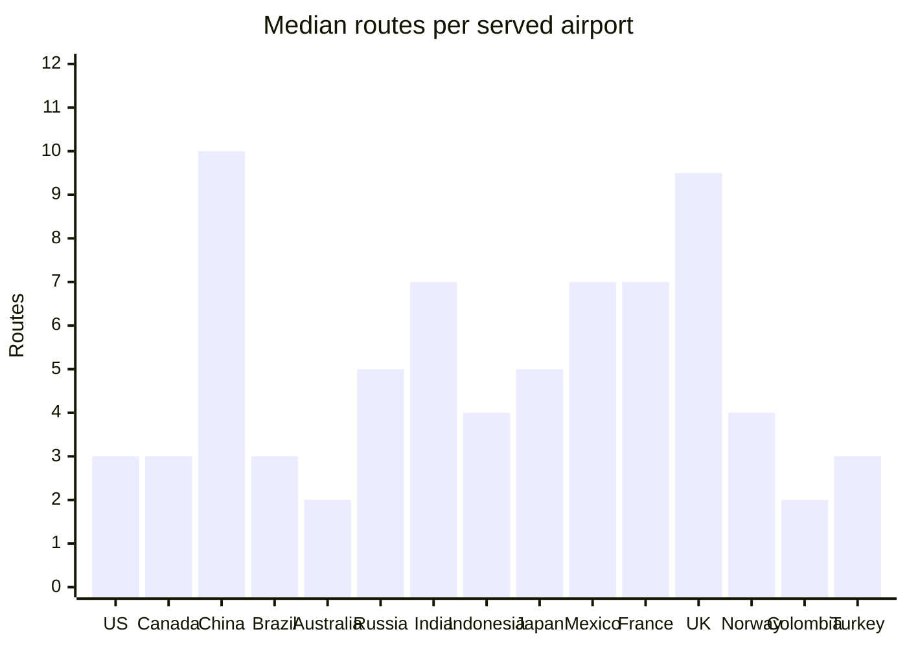
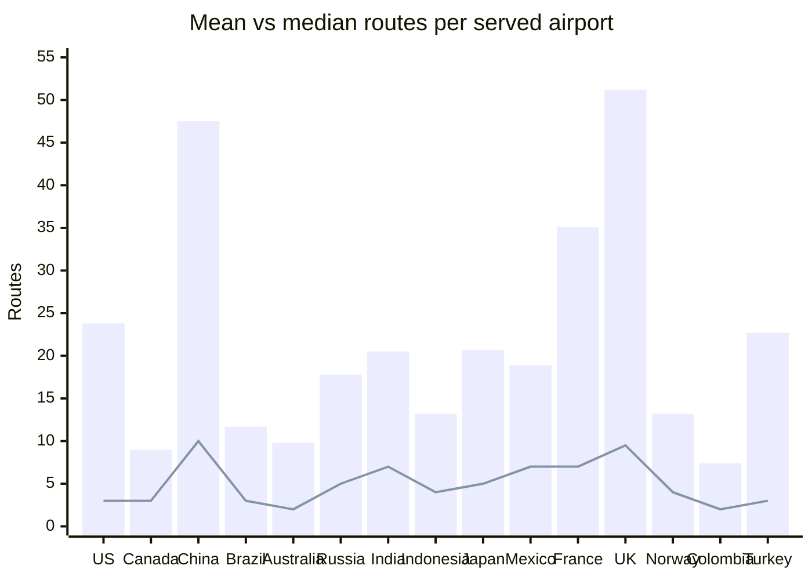
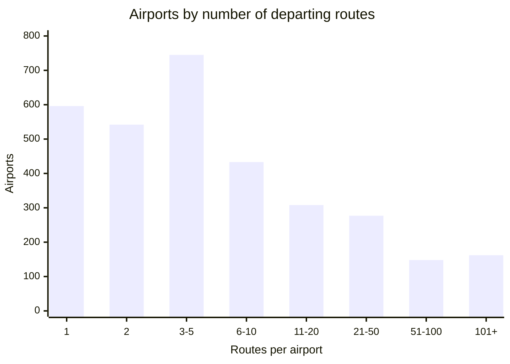
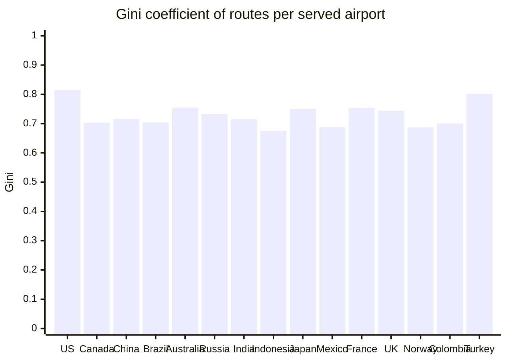

A project for area 2, "Custom aggregate functions in SQL" for the [MariaDB student database projects, 2026-09](https://mariadb.org/bachelor_hackathon_2026-09/).

# Custom aggregate functions in MariaDB

MariaDB lets you write your own aggregate function in SQL with `CREATE AGGREGATE FUNCTION` and `FETCH GROUP NEXT ROW`. MySQL has no SQL-level equivalent: there you write a C UDF or do without.

This repo builds two aggregates and uses them on the [openflights](https://github.com/mariadb/openflights) data:

| Function | Status | Question it answers |
|---|---|---|
| `median_agg(x)` | working | What is the typical number of routes per airport in a country? |
| `gini(x)` | working | How concentrated are a country's routes in a few airports? |

Each one is shown next to the query you would write without it.

## Findings so far

Data: 3,211 airports with at least one departing route. World mean is 20.9 routes per airport, median is 4, max is 915.

- Most airports are small. 1,883 of 3,211 (59%) have 5 routes or fewer, while 162 hubs have more than 100.
- Because of that, the mean is misleading. In the US the mean is 23.8 routes per airport but the median is 3. A few hubs pull the mean up.
- That is why a median aggregate is worth having: it gives the typical airport, not the hub-inflated average.
- `gini(x)` puts a number on that concentration (0 = all airports equal, close to 1 = one hub has almost everything). World value: 0.776. Among the 15 biggest countries the US is the most concentrated (0.815) and Indonesia the least (0.675).

Timings (with vs without the custom aggregate) come later.

### Chart 1: Median routes per airport, top 15 countries



Countries are the 15 with the most served airports, from left to right.

### Chart 2: Mean (bars) vs median (line)



The gap between the bar and the line shows how much a few big hubs distort the mean.

### Chart 3: How many routes airports have (whole world)



### Chart 4: Gini of routes per airport, top 15 countries



All chart numbers come from [queries/chart_data.sql](queries/chart_data.sql) on MariaDB 12.3.3. Charts are Mermaid, so GitHub draws them from the text above.

## Requirements

- Docker with Compose (tested with Colima on an Intel Mac)
- MariaDB 12.3.3 (image `mariadb:lts` from the openflights compose file, checked with `SELECT VERSION();`)

## Setup

1. Start MariaDB with the openflights data:

   ```sh
   git clone https://github.com/mariadb/openflights.git
   cd openflights
   docker compose up --wait
   cd ..
   ```

2. Install the view and the functions (one step):

   ```sh
   cat sql/*.sql | docker exec -i openflights-mariadb mariadb -uroot -pflightpw flightdb2
   ```

3. Run a query:

   ```sh
   docker exec -i openflights-mariadb mariadb -uroot -pflightpw flightdb2 < queries/median_after.sql
   ```

The password `flightpw` comes from the openflights compose file and is for local use only.

## Data model

| Object | What it is |
|---|---|
| `airports`, `routes` | openflights tables, unchanged |
| `served_airports` (view) | one row per airport with at least one departing route: `apid`, `name`, `country`, `routes` |

Airports with no routes are left out. Most of them are small airfields, and including them as zeros would hide the shape of real traffic.

## Before and after

| Query | Without the custom aggregate | With it |
|---|---|---|
| Median routes per airport, per country | [queries/median_before.sql](queries/median_before.sql) | [queries/median_after.sql](queries/median_after.sql) |

| Gini of routes per airport, per country | [queries/gini_before.sql](queries/gini_before.sql) | [queries/gini_after.sql](queries/gini_after.sql) |

[queries/median_check.sql](queries/median_check.sql) and [queries/gini_check.sql](queries/gini_check.sql) check that both versions give the same numbers (0 rows = they agree for every country).

### A trap found on the way

The first hand-written Gini query and the first `gini` function both returned slightly wrong numbers (e.g. `0.000000000333` instead of `0` for three equal values). The cause: in MariaDB, `INT / INT` is computed as DECIMAL and kept to `div_precision_increment` decimals (default 4). So `(n + 1) / n` became `1.3333`. Both versions now cast to DOUBLE. The custom function hides this fix in one place; every hand-written copy of the formula has to remember it.

## How it was made

- Made by Ayoub Labrinssi.
- AI use is recorded in [ai-log/AI-use log.md](ai-log/AI-use%20log.md).
