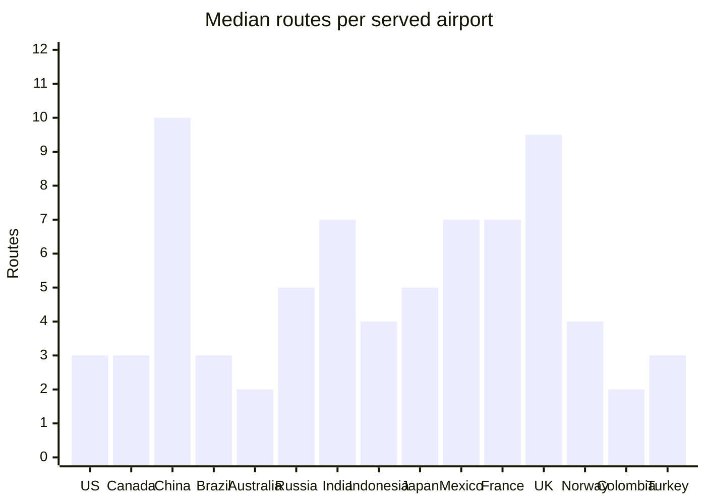
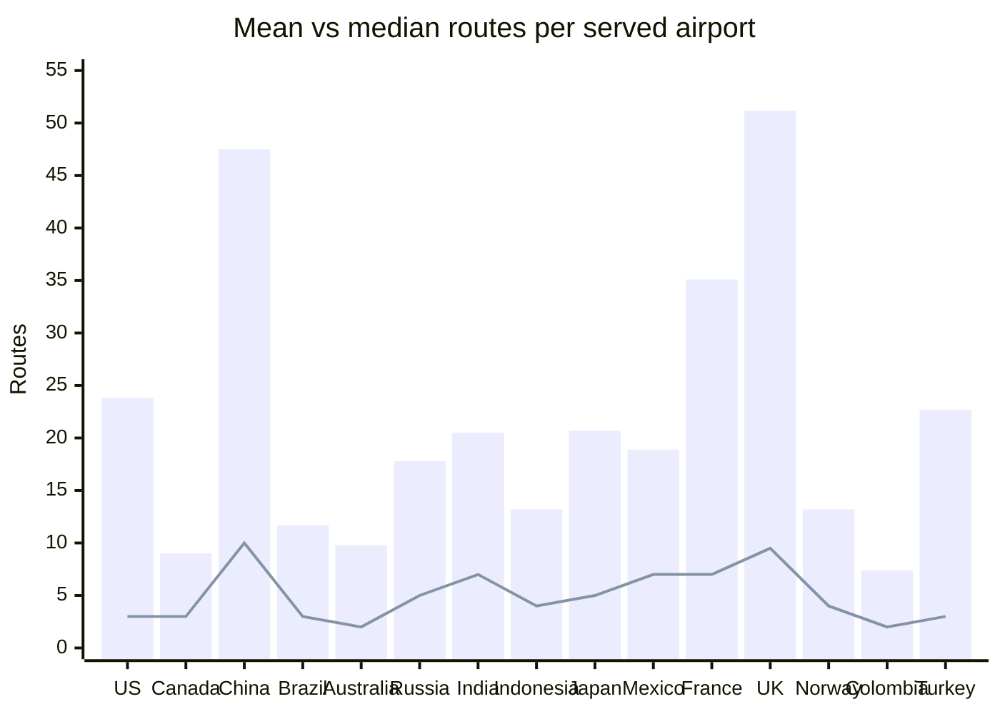
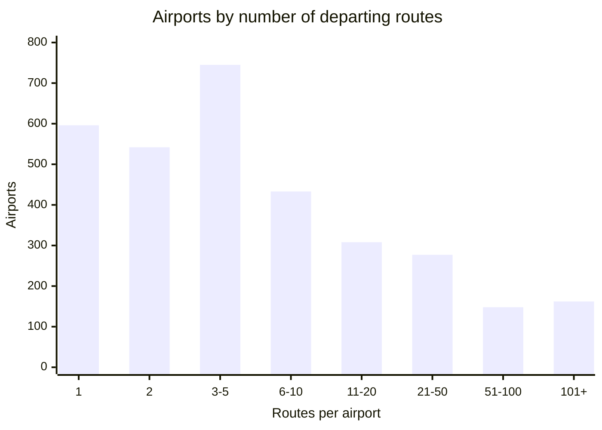
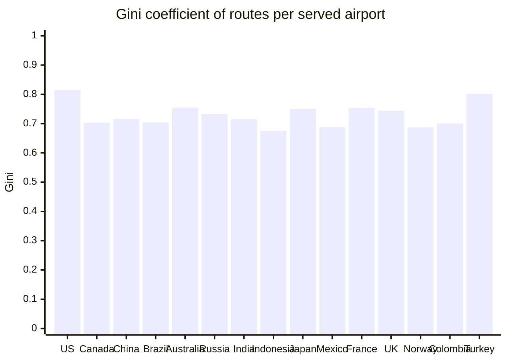
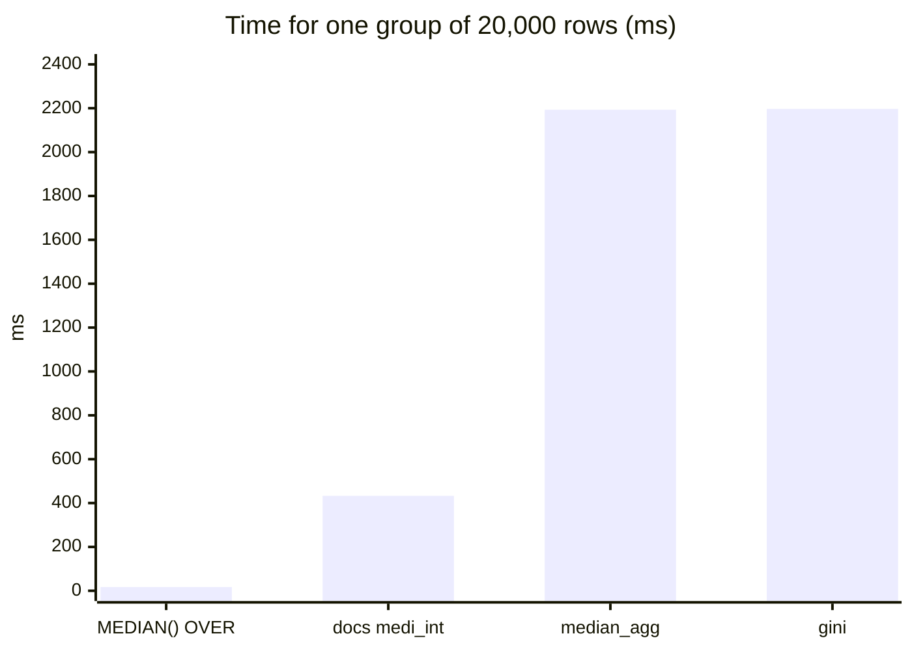

A project for area 2, "Custom aggregate functions in SQL" for the [MariaDB student database projects, 2026-09](https://mariadb.org/bachelor_hackathon_2026-09/).

# Custom aggregate functions in MariaDB

MariaDB lets you write your own aggregate function in SQL with `CREATE AGGREGATE FUNCTION` and `FETCH GROUP NEXT ROW`. MySQL has no SQL-level equivalent: there you write a C UDF or do without.

This repo builds three aggregates and uses them on the [openflights](https://github.com/mariadb/openflights) data:

| Function | Status | Question it answers |
|---|---|---|
| `median_agg(x)` | working | What is the typical number of routes per airport in a country? |
| `gini(x)` | working | How concentrated are a country's routes in a few airports? |
| `mode_agg(x)` | working | Which airline runs the most routes from each country? (works on text) |

Each one is shown next to the query you would write without it.

Status: a student project, tested on MariaDB 12.3.3 only. Fine for learning and analysis, not tested for production use.

## Findings so far

Data: 3,211 airports with at least one departing route. World mean is 20.9 routes per airport, median is 4, max is 915.

- Most airports are small. 1,883 of 3,211 (59%) have 5 routes or fewer, while 162 hubs have more than 100.
- Because of that, the mean is misleading. In the US the mean is 23.8 routes per airport but the median is 3. A few hubs pull the mean up.
- That is why a median aggregate is worth having: it gives the typical airport, not the hub-inflated average.
- `gini(x)` puts a number on that concentration (0 = all airports equal, close to 1 = one hub has almost everything). World value: 0.776. Among the 15 biggest countries the US is the most concentrated (0.815) and Indonesia the least (0.675).
- `mode_agg(x)` finds the airline with the most departing routes in each country. Often it is not the national airline. Ryanair is on top in 7 countries, including the UK, Spain and Italy. Ethiopian Airlines is on top in 9 countries, 8 of them outside Ethiopia (Benin, Chad, Gabon, Guinea, Malawi, Mali, Niger, Togo). In Morocco it is Royal Air Maroc, with 117 of 310 routes.

Timings, limits and a comparison with the docs' own example are in [Past the docs](#past-the-docs-what-we-tested) and [Speed](#speed).

### Chart 1: Median routes per airport, top 15 countries



Countries are the 15 with the most served airports, from left to right.

### Chart 2: Mean (bars) vs median (line)



The gap between the bar and the line shows how much a few big hubs distort the mean.

### Chart 3: How many routes airports have (whole world)



### Chart 4: Gini of routes per airport, top 15 countries



All chart numbers come from [queries/chart_data.sql](queries/chart_data.sql) on MariaDB 12.3.3. Charts are Mermaid, so GitHub draws them from the text above.

## Requirements

- Docker with Compose (tested with Colima on an Intel Mac)
- MariaDB 12.3.3 (image `mariadb:lts` from the openflights compose file, checked with `SELECT VERSION();`)

## Setup

1. Start MariaDB with the openflights data:

   ```sh
   git clone https://github.com/mariadb/openflights.git
   cd openflights
   docker compose up --wait
   cd ..
   ```

2. Install the view and the functions, then run the tests:

   ```sh
   ./install.sh
   ./test.sh
   ```

3. Run a query:

   ```sh
   DBPW=flightpw
   docker exec -i openflights-mariadb mariadb -uroot -p"$DBPW" flightdb2 < queries/median_after.sql
   ```

The password `flightpw` comes from the openflights compose file and is for local use only. The scripts read it from `DBPW` (default `flightpw`), so it is set in one place.

## Try it on your own table

After `./install.sh` the functions work on any table in `flightdb2`. For example:

```sql
CREATE TABLE grades (course VARCHAR(20), student VARCHAR(20), grade DOUBLE, letter CHAR(1));
INSERT INTO grades VALUES
  ('SQL', 'Ana', 1.3, 'A'), ('SQL', 'Ben', 2.7, 'B'), ('SQL', 'Cem', 1.0, 'A'),
  ('Java', 'Ana', 3.3, 'B'), ('Java', 'Ben', 2.0, 'B'), ('Java', 'Cem', 4.0, 'D');

SELECT course,
       median_agg(grade) AS median_grade,
       gini(grade)       AS spread,
       mode_agg(letter)  AS most_common_letter
FROM grades
GROUP BY course;
```

| course | median_grade | spread | most_common_letter |
|---|---|---|---|
| Java | 3.3 | 0.143 | B |
| SQL | 1.3 | 0.227 | A |

Use them like `AVG()` or `COUNT()`: in a `SELECT` with `GROUP BY`. They do not work with `OVER`, `DISTINCT` or directly in `HAVING` (see below).

## Data model

| Object | What it is |
|---|---|
| `airports`, `routes`, `airlines` | openflights tables, unchanged |
| `served_airports` (view) | one row per airport with at least one departing route: `apid`, `name`, `country`, `routes` |

Airports with no routes are left out. Most of them are small airfields, and including them as zeros would hide the shape of real traffic.

## Before and after

| Query | Without the custom aggregate | With it |
|---|---|---|
| Median routes per airport, per country | [queries/median_before.sql](queries/median_before.sql) | [queries/median_after.sql](queries/median_after.sql) |
| Gini of routes per airport, per country | [queries/gini_before.sql](queries/gini_before.sql) | [queries/gini_after.sql](queries/gini_after.sql) |
| Top airline per country | [queries/mode_before.sql](queries/mode_before.sql) | [queries/mode_after.sql](queries/mode_after.sql) |

[queries/median_check.sql](queries/median_check.sql), [queries/gini_check.sql](queries/gini_check.sql) and [queries/mode_check.sql](queries/mode_check.sql) check that both versions give the same result (0 rows = they agree for every country).

### A trap found on the way

The first hand-written Gini query and the first `gini` function both returned slightly wrong numbers (e.g. `0.000000000333` instead of `0` for three equal values). The cause: in MariaDB, `INT / INT` is computed as DECIMAL and kept to `div_precision_increment` decimals (default 4). So `(n + 1) / n` became `1.3333`. Both versions now cast to DOUBLE. The custom function hides this fix in one place; every hand-written copy of the formula has to remember it.

## Past the docs: what we tested

The MariaDB docs show how to write a stored aggregate, with a median example, but say little about where it breaks. These experiments check that. Each one is a SQL file in [experiments/](experiments/) with its output saved in [results/](results/). All runs are on MariaDB 12.3.3.

### The docs' median vs ours

The docs' example (`medi_int`, copied as written in [experiments/01_docs_median.sql](experiments/01_docs_median.sql)) stores the group in a temporary table `tt`. Ours stores it in a variable.

| Case | Docs `medi_int` | Our `median_agg` |
|---|---|---|
| Median of every country | same as ours (0 differences) | same as built-in `MEDIAN()` |
| `(5, NULL, 1)` | 1 (wrong: the NULL is stored and sorts first) | 3 |
| `(1.5, 2.5)` | 2.5 (wrong: the INT parameter rounds the inputs to 2 and 3) | 2 |
| Called twice in one SELECT | `ERROR 1050 Table 'tt' already exists` | works |
| Next call after that error | fails too: `tt` was left behind | works |
| Group of 20,000 rows | 433 ms | 2,193 ms |

The clash is a known server issue: [MDEV-17246](https://jira.mariadb.org/browse/MDEV-17246) "Stored Functions need their own temporary table namespace" (open). So the docs' version is faster on big groups but cannot be used twice in one query. Ours is safe to combine, but slower on big groups (see Speed).

### What works and what does not

| Use | Works? | Notes |
|---|---|---|
| As a window function, `median_agg(x) OVER (...)` | no, `ERROR 1064` | Stored aggregates cannot be window functions. Tracked in [MDEV-11263](https://jira.mariadb.org/browse/MDEV-11263) (stalled). Use the built-in `MEDIAN() OVER` instead. |
| `median_agg(DISTINCT x)` | no, `ERROR 1064` | Workaround: `SELECT median_agg(r) FROM (SELECT DISTINCT routes AS r ...) d` |
| In `HAVING`, e.g. `HAVING gini(routes) > 0.8` | no, `ERROR 1054 Unknown column 'routes' in 'HAVING'` | Built-in `SUM`/`AVG` work there. Same error on a plain table with 2 columns. Workarounds: use the alias (`HAVING g > 0.8`) or a derived table. We found no JIRA issue for this (searched 11 Oct 2026). |
| In `ORDER BY` | yes | |
| `WITH ROLLUP` | yes | Germany 22.5, Morocco 11, total 18 |
| Two custom aggregates in one SELECT | yes | |
| Inside a view definition | yes | [MDEV-28475](https://jira.mariadb.org/browse/MDEV-28475) did not show up here ([experiments/03](experiments/03_view_subquery.sql)) |
| In a correlated subquery | yes | 0 differences against GROUP BY for every country ([MDEV-21161](https://jira.mariadb.org/browse/MDEV-21161) did not show up here) |
| Empty group | returns NULL | Right for a median. A custom count would also return NULL, not 0: [MDEV-24580](https://jira.mariadb.org/browse/MDEV-24580) |
| Text input, `median_agg(name)` | no, `ERROR 1366` | in strict mode, which is the default |

Edge cases (odd/even counts, NULLs, negatives, decimals, empty groups, Gini of equal values, ties, text with commas and quotes, Arabic text) are in [tests/tests.sql](tests/tests.sql): 27 tests plus the 3 check queries. Run them with `./test.sh`.

## Speed

[experiments/04_scale.sql](experiments/04_scale.sql) times each function on one group of n generated rows (Sequence engine, same values every run). Each size is run 10 times. The table shows the median time with the fastest and slowest run. Full output: [results/04_scale.txt](results/04_scale.txt).

| Rows in the group | `AVG` (baseline) | built-in `MEDIAN() OVER` | docs `medi_int` | `median_agg` | `gini` | first `median_agg` (JSON) |
|---|---|---|---|---|---|---|
| 100 | 0.2 ms | 0.3 ms | 2.6 ms | 1.2 ms | 1.2 ms | 2.6 ms |
| 1,000 | 0.4 ms | 0.9 ms | 21 ms | 15 ms | 16 ms | 106 ms |
| 5,000 | 1.9 ms | 4.5 ms | 119 ms | 167 ms | 178 ms | 2,792 ms |
| 10,000 | 3.8 ms | 8.2 ms | 205 ms (198 to 317) | 614 ms (572 to 714) | 603 ms (574 to 755) | 10,271 ms (9,954 to 14,802) |
| 20,000 | 6.3 ms | 17 ms | 433 ms | 2,193 ms | 2,197 ms | not run |

Mac: Intel, 2017. MariaDB runs in Colima (2 CPUs, 4 GB).



What this shows:

- **Our first version was very slow on big groups.** It used `JSON_ARRAY_APPEND` for every row, which reads and copies the whole array each time: 10 s for 10,000 rows. Keeping the values in a plain text list and reading it as JSON only once at the end gives the same results 17 times faster (614 ms). That old version is kept in [experiments/05_faster_median.sql](experiments/05_faster_median.sql) and checked against the new one.
- **The cost still grows faster than the group.** Doubling the rows from 10,000 to 20,000 makes `median_agg` about 3.6 times slower, because the text list is copied when it grows. The docs' temp-table version grows in line with the rows.
- **A built-in is always faster.** `MEDIAN() OVER` is about 125 times faster than `median_agg` at 20,000 rows.
- **`mode_agg` hits the same wall on real data.** Top airline per country over all 67,663 routes takes 5.2 s with `mode_agg` and 0.44 s with the hand-written `ROW_NUMBER()` query (10 runs, [results/06_mode_timing.txt](results/06_mode_timing.txt)). Most of that time is the US group, which has 13,056 routes.
- For the median and Gini on openflights none of this matters: the biggest group is the US with 550 airports, and `median_agg` plus `gini` over all 225 countries take about 0.5 s.

One timing run first came out negative (the VM clock was corrected while it ran), so that size was run again.

## When not to use a custom aggregate

- **When a built-in does the job.** For a median use `MEDIAN()` or `PERCENTILE_CONT()` as window functions. They are far faster.
- **On big groups** (tens of thousands of rows in one group). A stored aggregate that has to keep every value gets slow. Pre-aggregate, or use a built-in.
- **When you need it as a window function, with DISTINCT, or directly in HAVING.** None of these work (see the table above).
- **When the function needs a temporary table** and may be called twice in one query. Keep state in variables instead.

Use one when there is no built-in (like Gini), when the formula is easy to get wrong by hand (see the DECIMAL trap above), and when the same logic is reused in many queries.

### Other databases

- **PostgreSQL** has `CREATE AGGREGATE` with a state function and a final function, written in SQL or PL/pgSQL. It can be used as a window function.
- **MySQL** has no SQL-level aggregates. You write a C UDF.
- MariaDB 13.2 is adding a C plugin interface for aggregates: [MDEV-40672](https://jira.mariadb.org/browse/MDEV-40672) "Pluggable aggregate functions" (in testing on 11 Oct 2026). That is for C code; this project stays in SQL.

## Repo layout

| Path | What is in it |
|---|---|
| `sql/` | the view and the three functions (installed by `install.sh`) |
| `queries/` | before/after/check queries and the chart data |
| `tests/` | edge-case tests (run by `test.sh`) |
| `experiments/` | the experiments behind "Past the docs" and "Speed" |
| `results/` | the saved output of each experiment |
| `AI-log.md` | AI log: every AI use and its prompt |

## License, contributing and help

- License: MIT, see [LICENSE](LICENSE).
- Contributing: how to report a bug, suggest a feature or add a function is in [CONTRIBUTING.md](CONTRIBUTING.md).
- Code of conduct: [CODE_OF_CONDUCT.md](CODE_OF_CONDUCT.md) (Contributor Covenant 2.1).
- Help: open an [issue](https://github.com/ayoublabrinssi/Capstone-Starter-MariaDB-custom-aggregates/issues).

## How it was made

- Made by Ayoub Labrinssi.
- AI use is recorded in [AI-log.md](AI-log.md).
